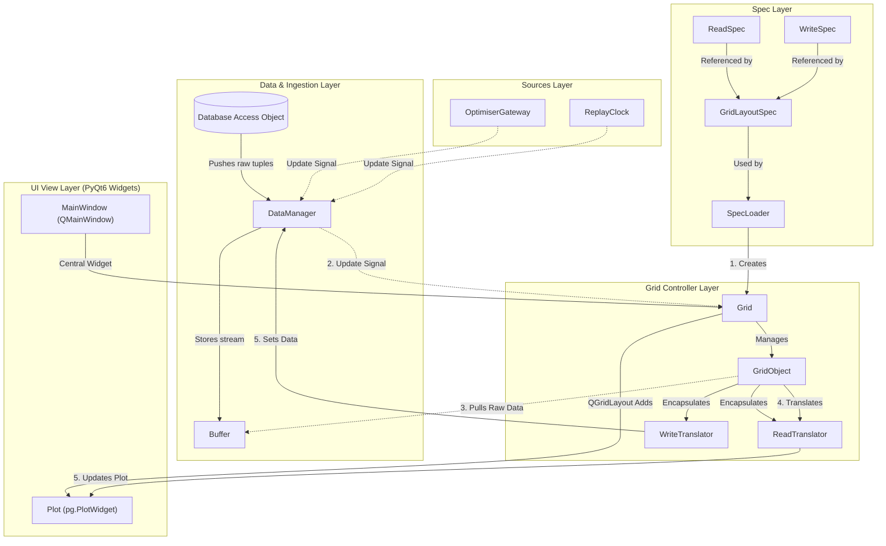

# Frontend Implementation Document
**Date:** 2026-09-23
**Scope:** the full rewrite of `src/frontend/`.

Old `src/frontend` is bloated and difficult to understand. The new frontend refactor plans to be more readable, and more easily workable.

The new implementation follows these basic rules:
1. Every class has one role.
2. Every method does one action.
3. Readability is over all else.

## Overview
Folder structure:
```
.
├── engine
│   └── data_manager.py
├── main.py
├── sources
│   ├── optimiser_gateway.py
│   └── replay_clock.py
├── specs
│   └── spec.py
├── translators
│   └── translators.py
├── utils
│   ├── buffer.py
│   ├── result.py
│   └── status.py
└── view
    ├── grid.py
    ├── main_window.py
    ├── plot.py
    └── theme.py
```

Mermaid diagram showing rough class interactions between these modules:



Legend:
- Solid lines represent relationships
- Dotted lines represent signals

## Data flows

**Time-step (replay, reading):**
1. `ReplayClock` announces a new time.
2. `DataManager` fetches from `FrontendDao`, overwrites stale data, and updates `Buffer`s. `updated` signal emits, referencing changed buffers.
3. `Grid` now refreshes (only if visible), and grabs `dict` from `DataManager` and passes data to `GridItem`s.
4. `GridItem`s redraw if needed buffers are changed, passes payload to `ReadBinding` then to `Plot` or `WriteBinding` then set in `DataManager`.
5. (If `WriteBinding` pass, data gets set via `FrontendDao`).

## Classes

Each entry lists: job, must, must not, and its public interface (expected behaviour only).

### `*DAO`
Must get / set from the database _only_. All getter / setter methods must have a `@dtype([ ... ])` decorator that defines usage expectations for external classes.

Getter functions return a list of tuples ordered by `@dtype`. Setter functions must raise on failure.

### `OptimiserGateway`
Includes controlling (start and stop) the existing optimiser. (Optional) Optimiser updates signals propagate from here.

### `ReplayClock`
Tracks time-step of the current replay. If playing, instantiates a timer that emits a signal for DataManager to update.

| Member | Expected behaviour |
|---|---|
| `play()` | Starts advancing time at the replay cadence. |
| `pause()` | Stops advancing. Time stays where it is. |
| `seek(t)` | Jumps to time `t`. |
| `time_changed(t)` signal | Emitted every time the current time changes. |

### `SpecBuilder`
Builds the largest widget in heirarchy (except `MainWindow`, so right now its `Grid`) from a global definition or TOML directory of `GridSpec`s.

| Member | Expected behaviour |
|---|---|
| `build(root)` | Builds all specs from root or a global definition. |
|  | Raises on a duplicate `id` or `key`. |
|  | Raises when a spec `needs` an unknown key. |
|  | Raises when a layout names an unknown GridObject. |

### `DataManager`
DataManager's primary role is to manage all incoming and outgoing data. Specific responsibilties include:
- Owning all `Buffer`s
- Operating on `DAO` getter and setter methods
- Appropriately emitting an `updated`
- Discarding stale data in `Buffer`s

| Member | Expected behaviour |
|---|---|
| `get(key)` | Returns corresponding `Buffer` if method `get_`s; `None` if `set_`s; Raises if unknown.|
| `set(key, form)` | Writes values to DB via `FrontendDao`; Raises on `get_`s or unknown `key`.|
| `get_ui(key)` | Spawns thread with timeout that waits for `key` to land, raises if it does not land in time. |
| `set_ui(key, value)` | Sets a UI field. |
| `set_time(t)` | Updates the time-dependent fields for time `t`. |
| `update` signal | Prompts 2nd largest in heirarchy widget to redraw (i.e. `Grid`) |

### `Buffer`
Holds data and returns it sorted by primary key. Requires `dtype` and `primary_key` args to function (raises error if primary key is not in `dtype`).

| Member | Expected behaviour |
|---|---|
| `dtype` | Made public so external classes know usage. |
| `set(records)` | Creates or overwrites records it stores. |
| `get` | Returns items sorted by primary key. |

### `ReadBinding`
Translates buffer data into dict payload for widgets.

| Member | Expected behaviour |
|---|---|
| `translate(data)` | Runs the spec's `select`, and returns the payload. |

### `WriteBinding`
Writes form payload via `DataManager.set()` function. Optionally accepts a `select` function, which translates data in `submit`.

| Member | Expected behaviour |
|---|---|
| `submit(form)` | Runs the spec's command with `form`. |

### `GridItem`
Represents item within a page. Must hold the following:
- optionally, `ReadBinding` and/or `WriteBinding`
- `id`, its plot, and correspondent text (e.g. for title, help, empty state...)
- `width` and `height`.

| Member | Expected behaviour |
|---|---|
| `needs` | `set` of keys required by translators. |
| `render(payload)` | Displays payload via some `Plot` widget. Shows an empty state, given no data.  |
| `show_error(message)` | Display errors (specifically for `WriteBinding`). |

### `Plot`
Abstract base class for every plot type.

| Member | Expected behaviour |
|---|---|
| `draw(payload)` | Draws on canvas with payload data. |

### `Grid`
- **Job:** lay out one page of GridObjects.
- **Must:**
  - Place each GridObject at its `(row, col)` with its `w × h`.
  - On `refresh`, redraw only dirty GridObjects, and only while visible.
  - Catch up on dirty GridObjects when it becomes visible.
- **Must not:** hold data.
- **Interface:**

Layout of `GridItem`s; Represents a page / tab. As the name suggests, the layout must be grid-like and raise errors on overlaps or OOBs from `GridItem` placement.

| Member | Expected behaviour |
|---|---|
| `n_rows`, `n_cols` | # of rows and columns the grid spans. |
| `needs` | Keys that its `GridItem`s rely on during updates. |
| `refresh(updated)` | Fetches data from `set` of updated keys, then updates relevant `GridObjects` |

### `MainWindow`
- **Job:** hold the Grids and replay controls, and wire parts together at startup.
- **Must not:** contain business logic, caching or refresh bookkeeping.
  Encapsulates and wires all previously defined classes with minimal logic: `SpecBuilder` builds widgets and `ReadBinding`s/`WriteBinding`s, `DataManager` wired to widgets.

---

## Specs
Declared data (not classes) that represent the whole UI.

| Spec | Must contain |
|---|---|
| `ReadSpec` | `build_translator()` and arguments required by `ReadBinding`. |
| `WriteSpec` | `build_translator()` and arguments required by `WriteBinding`. |

| `GridItemSpec` | `build_translator()` and arguments required by `GridItem`.|
| `GridSpec` | `build_translator()` and arguments required by `Grid`.|

- `SpecBuilder` will load from `specs/` and build declared specifications into widgets.
- Specifications may be globally defined and built, or defined in `specs/` and loaded in.

## Current page and refresh contracts (2026-10-15)

- Settings is a native navigation list and persistent content stack. Each section
  owns one scroll area and a single-panel Grid; FormView can disable its internal
  scroll wrapper. Switching sections must preserve drafts.
- Operation composes a KPI Grid, responsive chart Grid and controls Grid. Only the
  chart area scrolls. Grid's optional minimum column width applies to unit panels;
  declared positions remain unchanged for other grids.
- Grid coalesces dirty notifications and refreshes one controller per event-loop
  turn, only while visible. It catches up when shown. It holds no data and has no
  drag, layout preference or layout reset behaviour.
- DataManager has at most one snapshot fetch in flight and one pending refresh.
  Replay state publishes immediately; writes supersede older fetches. Buffer
  replacement reports whether its complete snapshot changed. Forecast fetches
  carry replay context; only the active optimiser interval's horizon is accepted.
  FrontendDao reuses the optimiser forecast loader and buffers one full issue.
  Forecast selectors keep the previous same-run past issue visible and label it
  as updating until the replacement arrives; an empty snapshot shows unavailable.
- LineGraphView keeps rendered payload copies only to skip identical draws. It
  reuses artists and margins, recalculating layout for resize, axes changes or
  text clipping/legend collisions. Optional payload subtitles identify forecast
  issues without forcing identical curves to redraw; empty payloads hide the chart.


### Selection details and replay controls

Configuration summaries receive plain records from the existing selectors and
use FormField metadata for display. Battery wear derivation belongs to the
selector layer and calls the existing BatteryConfig property; the specialised
battery form emits changed input values and receives a display-only rate through
page wiring. It retains FormView's submission fields and persistence behaviour.

ReplayClock announces playback-state and window changes. ReplayBarView uses these
to synchronise its media button and cancel gestures on run replacement. Timeline
movement previews elapsed simulation time; seeking occurs on release. UI updates
remain signal-blocked and never turn programmatic playback into user seeking.


Chart duration choices are Last 24 hours, Last 3 days and Last 7 days. Missing or
obsolete saved choices use 24 hours for both the picker and the plotted window.


House and battery editors provide an explicit Create new action. It starts a copy
of the shown values with a blank name and uses the existing submit/write path.
Unsubmitted drafts, including those without a name yet, survive list refreshes;
saved configurations retain their read-only rules. Configuration record selectors
order numeric ID segments naturally for both editors and simulation dropdowns.


RecordsPayload may supply display labels separately from record IDs. Settings
forms resolve saved selections through combo item data while new names remain
editable text; simulation submissions always use IDs. Preset display labels use
record specifications and preserve custom names. Previous runs uses ReadBinding's
optional-field contract for get_current_request, allowing saved-run selection at
startup without weakening other panels' empty-buffer checks. Run labels wrap and
show local dates plus a short stable run reference.


ReplayClock owns the session playback speed (1×, 1.5× or 2×) and exposes a change
signal to ReplayBarView's native Speed picker. Speed changes only adjust the
existing timer, with a 250 ms floor; they do not seek, skip simulation intervals,
start paused playback or affect optimiser execution. The existing bounded fetch
scheduler and coalesced rendering remain the only refresh mechanisms. Narrow
replay bars put the timeline on its own row beneath the media/speed controls.

### Community goal outcomes

Community returns a QWidget containing existing responsive Grids, with the
MainWindow wrapper remaining its only scroll owner. Its former fixed TOML layout
is removed. Three stable cards show goal improvement, recorded financial cost and
grid emissions; the comparison chart uses the selected saved run's objective.

Community-specific selectors reuse the current buffers, scenario helpers and
formatters. Financial results use realised_economic_cost_aud; emissions use
emissions_tonnes; Balanced adds the stored emissions_cost_aud to recorded financial
cost. Estimated terminal credits remain exclusive to Debrief's existing analysis.
Missing comparisons do not hide valid totals, and missing house counts suppress
only averages. The existing bar view has an opt-in empty-category state; its
default behavior is unchanged for other pages.

GoalSummaryView receives structured display facts through TabularPayload. It
separates the goal, run context and Balanced calculation, reflows its existing
calculation widgets into one column at narrow widths, and uses the same native
disclosure pattern as configuration summaries for secondary guidance. Run IDs
remain available in the context tooltip; calculations remain in selectors.
